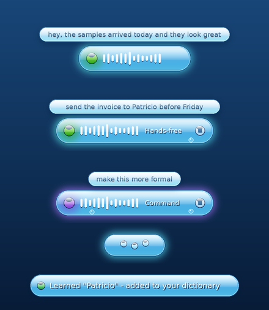

# Aqua Lite

Free, open-source voice dictation for Windows with a Frutiger Aero look.
Hold **Ctrl + Win**, speak, let go: clean, punctuated text appears wherever your cursor is, in WhatsApp, Gmail, Slack, Word, VS Code, ChatGPT or any other app.

Aqua Lite is an independent project inspired by how [Wispr Flow](https://wisprflow.ai) works. It is built from the public
[wispr-flow-rea-teardown](https://github.com/az9713/wispr-flow-rea-teardown) analysis and contains no Wispr code.
It is not affiliated with or endorsed by Wispr AI, Inc.

## Features

- **Push-to-talk and hands-free:** hold `Ctrl + Win`, or add `Space` to keep listening. The Flow bar stays out of the way and only appears while you're dictating.
- **Command Mode:** select text, hold `Ctrl + Win + Alt`, and say "make this formal", "translate to Arabic" or "turn this into bullets".
- **AI formatting:** removes fillers, applies self-corrections ("at 5, no wait, 6"), adds punctuation and lists, and writes numbers and emails properly. It never answers your dictation.
- **Styles per app:** casual in WhatsApp, formal in email, exact identifiers in code editors. Four editing strengths, from verbatim to polished.
- **Dictionary, replacements and voice snippets:** say "my email" and the full address is typed.
- **Works offline:** faster-whisper on your PC. Or use Groq, OpenAI, Anthropic, or a local LM Studio / Ollama server.
- **100+ languages**, including Arabic and mixed-language sentences. Nothing is ever translated.
- **Careful pasting:** your clipboard (text, images, rich text) is restored afterwards, and dictations stay out of Win+V history.
- **Music while you talk:** plays a random part of a song from your own music folder at 30% volume, then fades out.
- **History and stats**, a tray menu, start-with-Windows, and every shortcut can be changed.

## Install (Windows 10/11)

1. Download this repository (green **Code** button, then **Download ZIP**) and unzip it.
2. Double-click **`install.bat`**. It finds or installs Python 3.12, sets up a private environment in
   `%LOCALAPPDATA%\AquaLite`, runs a self-test, downloads the offline speech model (~480 MB, one time),
   and adds Start menu, Desktop and startup shortcuts.
3. Optional: paste a [Groq API key](https://console.groq.com/keys) under **Settings > Speech & AI**. Transcription becomes
   near-instant, and AI formatting and Command Mode turn on.

Aqua Lite updates itself: every time it starts, it checks GitHub for a newer version, installs it and restarts
(you'll see "Updated to ..." at the bottom of the screen). You can also pick **Check for updates** from the tray menu,
or turn automatic updates off in Settings. Running `install.bat` again also updates. To remove everything, run `uninstall.bat`.

## Shortcuts

| Shortcut | Action |
|---|---|
| Hold `Ctrl + Win` | Push-to-talk |
| `Ctrl + Win + Space` | Hands-free (press `Ctrl + Win` again to finish) |
| Hold `Ctrl + Win + Alt` | Command Mode on the selected text |
| `Alt + Shift + Z` | Paste the last transcript again |
| `Esc` | Cancel recording |

For hands-free, hold `Ctrl + Win`, tap `Space`, then let go and keep talking. Press `Ctrl + Win` again (or click the bar) to insert the text.
You can also start hands-free from the tray icon menu, or turn on **Keep the Flow bar on screen when idle** in Settings and click the bar.

Open Settings from the tray icon, or launch **Aqua Lite** from the Start menu while it's running.

## Privacy

In offline mode nothing leaves your PC. With a cloud provider, only the recording and the formatting request
(your dictionary plus the current app name and window title) go to that provider, using your own API key.
Settings and history are stored locally in `%APPDATA%\AquaLite`.

## How it works

`keyboard hook (WH_KEYBOARD_LL) -> 16 kHz mono mic -> speech-to-text -> AI formatter -> clipboard paste -> clipboard restore`

The paste step follows the behaviour documented in the teardown:
- all key-downs, then a 50 ms wait, then all key-ups, then another 50 ms
- clipboard restored after 500 ms (3 s for Outlook, Word and WhatsApp; 5 s for remote-desktop apps), and skipped if the clipboard changed meanwhile
- optional Shift+Insert in VS Code, Cursor and Windsurf
- waits while modifier keys are held, and masks Win/Alt so the Start menu doesn't pop up

Run `python AquaLite.pyw --selftest` to check the logic and the Windows integration without a microphone.

### Updates

On launch, the app reads [`VERSION`](VERSION) on the `main` branch. If it's higher than the installed one, it downloads
the repository zip, installs any new packages, runs the new version's self-test, backs up the current copy to
`%LOCALAPPDATA%\AquaLite\app.backup`, copies the new files over and restarts. If the self-test fails, nothing is changed.
It never updates a git checkout. **To ship an update, push the changes and bump `VERSION`** (e.g. `1.1.0` to `1.2.0`).

## Credits

- **[az9713](https://github.com/az9713)**, for the [wispr-flow-rea-teardown](https://github.com/az9713/wispr-flow-rea-teardown):
  the pipeline analysis, the paste rules, the app lists and the original `flowlite.py` prototype that this project grew from.
- **Eric Tech**, for the video "How To Use REA To Clone Any Software In Minutes", which the teardown follows.
- **Wispr AI, Inc.**, for [Wispr Flow](https://wisprflow.ai), the product that inspired this one. "Wispr Flow" is their trademark.
- **Sofi Xian / Consumer Aesthetics Research Institute**, who named the Frutiger Aero aesthetic.
- **Open-source projects** Aqua Lite is built on:
  [OpenAI Whisper](https://github.com/openai/whisper) (MIT),
  [faster-whisper](https://github.com/SYSTRAN/faster-whisper) (MIT),
  [CTranslate2](https://github.com/OpenNMT/CTranslate2) (MIT),
  [PyAV](https://github.com/PyAV-Org/PyAV) (BSD; uses FFmpeg, LGPL),
  [python-sounddevice](https://github.com/spatialaudio/python-sounddevice) (MIT) / [PortAudio](https://www.portaudio.com/) (MIT),
  [NumPy](https://numpy.org) (BSD),
  [Pillow](https://python-pillow.org) (MIT-CMU),
  [pystray](https://github.com/moses-palmer/pystray) (LGPL-3.0),
  [Requests](https://github.com/psf/requests) (Apache-2.0).
  These are installed from PyPI by `install.bat`, not bundled in this repository.

## License

[MIT](LICENSE). Third-party packages keep their own licenses. No music is included; the music feature only plays files you add yourself.
